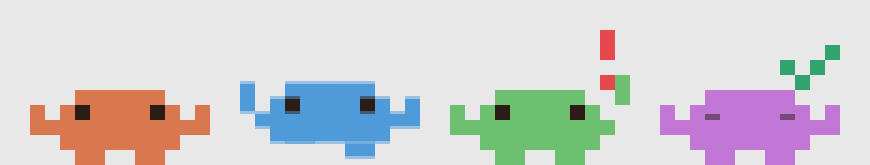

# Mini Clawd for Windows 🦀

**Tiny pixel critters that live on your taskbar and tell you what your Claude Code agents are up to.**



Left to right: **idle**, **working**, **needs you**, **done**.

Run five Claude Code sessions at once and you'll eventually forget which one is waiting on you. Mini Clawd gives every session its own little guy standing on the edge of your taskbar, so you can tell at a glance without alt-tabbing.

## Meet the cast

| Clawd | What's happening |
|---|---|
| 😌 **Idle** | Bobbing gently and blinking. Session started, nothing asked yet. |
| ⌨️ **Working** | Bouncing, typing furiously, feet shuffling. Claude is on it. |
| ❗ **Needs you** | Hopping and waving with a flashing red `!`. Claude is waiting on *you*. |
| ✅ **Done** | Jumps three times, then goes sleepy-eyed with a green check. |
| 👋 **Session ends** | Walks off to the right and fades out. Goodbye! |

Every session gets its own color, and hovering a clawd opens its dashboard. **Click a clawd to bring its terminal window to the front** (if the window can't be found, the clawd shakes). In Windows Terminal this raises the window but can't pick the tab. Clicks anywhere else pass straight through to your apps.

## Install

### Installer (recommended)

Download `Mini Clawd Setup x.y.z.exe` from the [latest release](https://github.com/moore-jt/MiniClawdForWindows/releases/latest) and run it. (Building it yourself: `npm run dist`; the file lands in `release/`.) It installs per-user, starts Mini Clawd, and on first run adds its hooks to `~/.claude/settings.json` (your file is backed up first). Turn on **Launch at login** from the tray menu and you never need a terminal again. Start a new Claude Code session and a clawd pops in.

The hooks run with `node`, so [Node.js](https://nodejs.org) must be on your PATH (it is if you installed Claude Code through npm). Uninstalling removes the hooks again. The tray menu's **Claude Code hooks** checkbox adds or removes them any time.

### From source

You'll need Windows, [Node.js](https://nodejs.org), and [Claude Code](https://claude.com/claude-code).

```bash
git clone https://github.com/moore-jt/MiniClawdForWindows
cd MiniClawdForWindows
npm install
npm run hooks:install   # teaches Claude Code to tell the clawds what's going on
npm start               # builds and launches the strip
```

Then start a new Claude Code session. A clawd should pop in above your taskbar.

To remove the hooks later: `npm run hooks:uninstall`. It only touches Clawd's own entries and backs up your `settings.json` first.

## How it works

Claude Code hooks (`SessionStart`, `UserPromptSubmit`, `Notification`, `Stop`, `SessionEnd`) run a tiny script that pings a localhost-only listener (`127.0.0.1:47821`). The script is fast, silent, and fails quietly if Clawd isn't running, so it never slows Claude down. The overlay is a transparent, click-through Electron window pinned above the taskbar.

## Try it without Claude

With the app running, in a second terminal:

```bash
npm run test:bus          # makes a test clawd cycle through its moods
node scripts/test-bus.js clear
```

## Troubleshooting

- **"already running; exiting this copy"**: a stray Electron is alive. Run `taskkill /F /IM electron.exe` and start again.
- **Moved the repo (source install)?** Re-run `npm run hooks:install`. The hook command stores an absolute path. The installed app keeps its hook in `%APPDATA%Mini Clawdhooks`, so moving it is safe.
- **Windows SmartScreen warns about the installer?** The build isn't code-signed. Choose *More info* then *Run anyway*.
- **Nothing appears after installing?** Check the tray (the `^` overflow arrow) for the clawd icon, make sure Node.js is on your PATH, and start a *new* Claude Code session. Sessions that were already open don't have the hooks.
- **Electron failed to install?** Run `node node_modules/electron/install.js` and give it a few minutes.

## Status

Early days. There's a tray icon (Clear done, Launch at login, Quit) and clawds whose Claude process died are cleaned up automatically. The first installer release (v0.1.0) is out on the [Releases page](https://github.com/moore-jt/MiniClawdForWindows/releases). It's unsigned for now. See [PLAN.md](PLAN.md) for the roadmap.

## License

MIT. The clawds are original pixel art, not Anthropic's official mascot.
