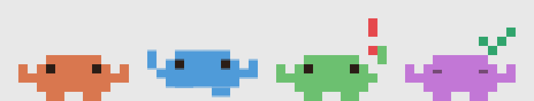

# Mini Clawd for Windows 🦀

**Tiny pixel critters that live on your taskbar and tell you what your Claude Code agents are up to.**



Left to right: **idle**, **working**, **needs you**, **done**.

Run five Claude Code sessions at once and you'll eventually forget which one is waiting on you. Mini Clawd gives every session its own little guy standing on the edge of your taskbar, so you can tell at a glance without alt-tabbing.

## Meet the cast

| Clawd | What's happening |
|---|---|
| 😌 **Idle** | Bobbing gently and blinking. Session started, nothing asked yet. |
| ⌨️ **Working** | Bouncing, typing furiously, feet shuffling. Claude is on it. |
| ❗ **Needs you** | Hopping and waving with a flashing red `!`. Claude is waiting on *you*. |
| ✅ **Done** | Jumps three times, then goes sleepy-eyed with a green check. |
| 👋 **Session ends** | Walks off to the right and fades out. Goodbye! |

Every session gets its own color, and hovering a clawd shows its project folder. Clicks anywhere else pass straight through to your apps.

## Install

You'll need Windows, [Node.js](https://nodejs.org), and [Claude Code](https://claude.com/claude-code).

```bash
git clone https://github.com/moore-jt/MiniClawdForWindows
cd MiniClawdForWindows
npm install
npm run hooks:install   # teaches Claude Code to tell the clawds what's going on
npm start               # builds and launches the strip
```

Then start a new Claude Code session. A clawd should pop in above your taskbar.

To remove the hooks later: `npm run hooks:uninstall`. It only touches Clawd's own entries and backs up your `settings.json` first.

## How it works

Claude Code hooks (`SessionStart`, `UserPromptSubmit`, `Notification`, `Stop`, `SessionEnd`) run a tiny script that pings a localhost-only listener (`127.0.0.1:47821`). The script is fast, silent, and fails quietly if Clawd isn't running, so it never slows Claude down. The overlay is a transparent, click-through Electron window pinned above the taskbar.

## Try it without Claude

With the app running, in a second terminal:

```bash
npm run test:bus          # makes a test clawd cycle through its moods
node scripts/test-bus.js clear
```

## Troubleshooting

- **"already running; exiting this copy"**: a stray Electron is alive. Run `taskkill /F /IM electron.exe` and start again.
- **Moved the repo?** Re-run `npm run hooks:install`. The hook command stores an absolute path.
- **Electron failed to install?** Run `node node_modules/electron/install.js` and give it a few minutes.

## Status

Early days. Still on the to-do list: a tray icon with Quit, a movable strip, and launch at login. See [PLAN.md](PLAN.md) for the roadmap.

## License

MIT. The clawds are original pixel art, not Anthropic's official mascot.
